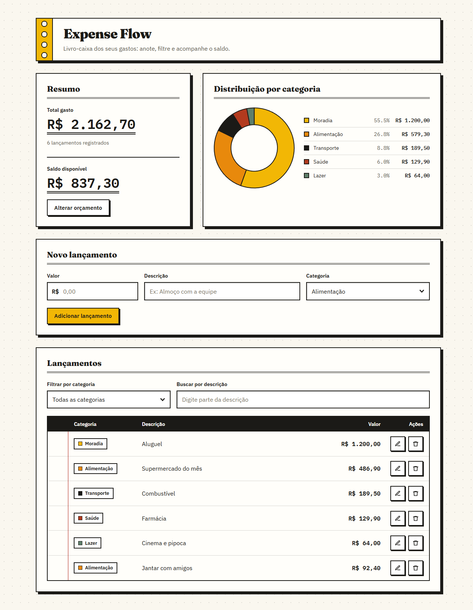

# Expense Flow

Livro-caixa pessoal no navegador: anote seus lançamentos, filtre por categoria e acompanhe quanto ainda cabe no orçamento.

**[Abrir o app →](https://l3-v1.github.io/expense-flow/)**



## Funcionalidades

- **Lançamentos**: adicione, edite e exclua lançamentos com valor, descrição e categoria. A exclusão pede confirmação.
- **Categorias**: Alimentação, Transporte, Moradia, Saúde, Lazer, Educação, Compras e Outros.
- **Orçamento**: defina um orçamento opcional e veja o **saldo disponível**. Se ele ficar negativo, o app avisa que o orçamento estourou.
- **Filtros**: filtre a lista por categoria ou busque por parte da descrição.
- **Distribuição por categoria**: gráfico de rosca com o total e o percentual de cada categoria, considerando os filtros ativos.
- **Dados locais**: tudo fica no `localStorage` do seu navegador. Não há servidor nem conta, e os dados não saem do seu dispositivo.

## Stack

Sem etapa de build e sem dependências instaladas: HTML e módulos ES, com bibliotecas carregadas por CDN.

- [Alpine.js](https://alpinejs.dev/) 3 para reatividade
- [Tailwind CSS](https://tailwindcss.com/) (Play CDN) para estilos
- [Chart.js](https://www.chartjs.org/) 4 para o gráfico

## Como rodar localmente

Módulos ES não carregam via `file://`, então sirva a pasta por HTTP:

```sh
npx serve .
# ou
python -m http.server 8000
```

Depois abra o endereço indicado no terminal. Para voltar ao estado vazio, apague a chave `expenseFlow.v1` do `localStorage`.

## Estrutura

```
index.html                 marcação, configuração do Tailwind e CSS
src/
  main.js                  expõe o componente Alpine (window.expenseFlow)
  controllers/             componente Alpine: estado, valores derivados e ações
  models/                  regras de negócio puras (validação, orçamento, categorias)
  services/                efeitos colaterais (localStorage, Chart.js)
  utils/format.js          formatação de moeda (pt-BR / BRL)
docs/plans/                planos aprovados
GLOSSARY.md                vocabulário do domínio
```

## Publicação no GitHub Pages

O site é servido direto da raiz do branch `main`, sem build nem workflow. O arquivo `.nojekyll` faz o GitHub servir os arquivos como estão.

Para ativar (só na primeira vez): em **Settings → Pages → Build and deployment**, escolha **Deploy from a branch**, branch **`main`** e pasta **`/ (root)`**. A partir daí, cada push no `main` publica de novo o site em `https://l3-v1.github.io/expense-flow/`.

## Licença

[MIT](LICENSE)
